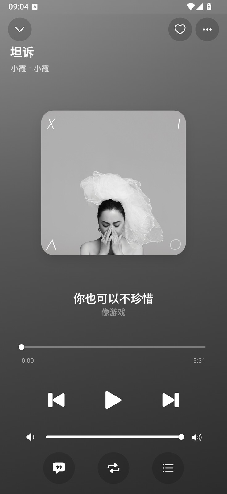
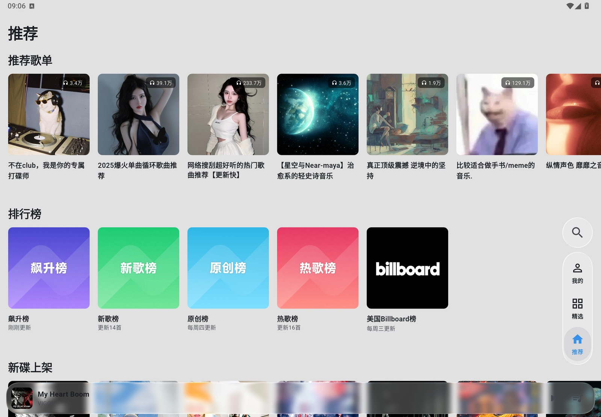
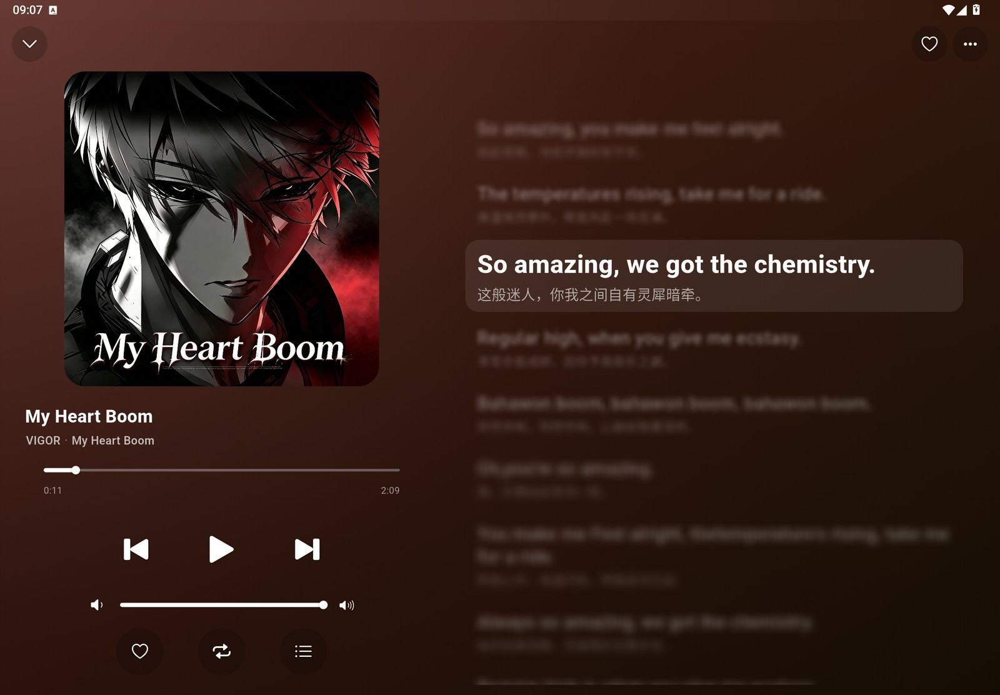
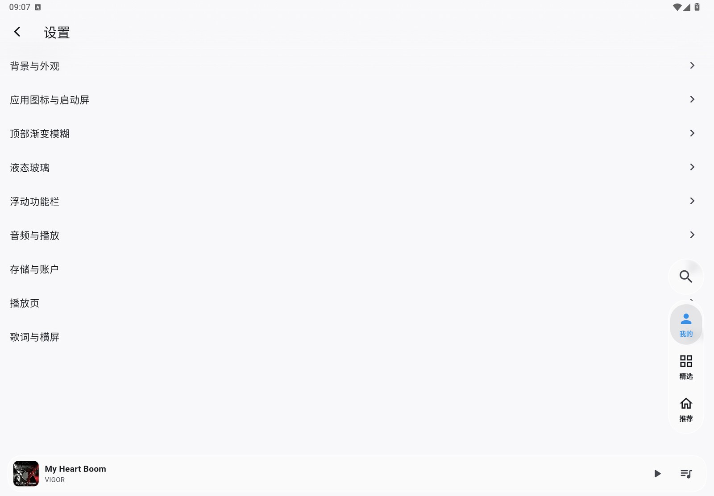

> [!IMPORTANT]
> 本项目是 Kumone 的非官方 Android 派生版本，与网易云音乐及其他音乐平台无隶属、授权或背书关系。以非商业的学习交流为项目定位，不提供歌曲下载、评论或私信等社交功能。音乐、封面、歌词等内容的权利归各自权利人及来源平台所有。

<div align="center">


# Kumone Android

**雲の音 — 以 Flutter 重构的 Android 音乐播放器**

源自 Kumone · 液态玻璃界面 · 沉浸歌词 · 手机与平板自适应

[](#构建)
[](pubspec.yaml)
[](LICENSE)

[原版 Kumone](https://github.com/missuo/kumone) · [自定义音源](docs/CUSTOM_SOURCES.md) · [第三方归属](THIRD_PARTY_NOTICES.md)

</div>

## 界面展示

<p align="center">
  
</p>

<table>
  <tr>
    <td align="center"><br />平板推荐页 · 浮动导航</td>
    <td align="center"><br />双栏播放页 · 同步歌词</td>
  </tr>
  <tr>
    <td colspan="2" align="center"><br />设置分类 · mini 播放器</td>
  </tr>
</table>

<sub>截图仅用于展示应用界面，所示音乐、歌词及封面权利归各自权利人所有。</sub>

## 关于项目

**Kumone** 源于日语「雲の音」——云端传来的声音。名称及原始项目来自 [missuo/kumone](https://github.com/missuo/kumone)。

本项目是原版 Swift Kumone 的 **Flutter / Android 行为级迁移**：不是将 Swift 文件机械地逐个翻译为 Dart，而是迁移原工程的 API、数据模型、播放行为与 UI 信息架构，并围绕 Android 的后台播放、系统媒体会话、触控操作和多尺寸窗口重新实现。

界面使用 [liquid_glass_easy](https://github.com/AhmeedGamil/liquid_glass_easy) 构建玻璃视觉与交互。Android 版独立维护，不代表原作者的官方 Android 发布。

## 功能

- 🔐 **账号登录** — 扫码及手机号登录，本机安全存储登录凭据。
- 🏠 **发现音乐** — 每日推荐、私人漫游、推荐歌单、榜单、新专辑和歌手。
- 🧭 **精选与搜索** — 分类歌单，以及歌曲、专辑、歌手、歌单的分类与综合搜索。
- 🎵 **音乐播放** — 基于 `just_audio` 与 `audio_service`，支持后台播放、系统媒体控制、顺序播放、随机播放、单曲循环及下一首播放。
- 🖼 **沉浸播放页** — 封面取色氛围背景、歌曲信息滚动、进度与音量控制；手机横屏和平板采用封面／控制与歌词双栏布局。
- 📝 **歌词** — 同步歌词、逐词高亮、翻译、日文读音、模糊与字号调节。
- 📚 **音乐库** — 喜欢的音乐、创建及收藏歌单、收藏专辑、关注歌手、最近播放和音乐云盘。
- ✏️ **歌单管理** — 创建、删除与收藏歌单，添加和移除歌曲；列表中的当前播放歌曲以主题色加粗标记。
- 🫧 **玻璃界面** — 浮动 mini 播放器、玻璃导航与菜单、渐变模糊顶栏、横屏浮动功能栏。
- 🎨 **个性化** — 明暗外观、五种主题强调色、横竖屏独立壁纸及裁切、九款桌面图标与绑定启动屏。
- ⚙️ **用户音源配置** — 最多七个自定义解析服务，支持单独启停、编辑、删除和顺序调整；不内置第三方音源服务。

> 部分功能依赖账号权限、接口可用性及设备支持。原版的 CarPlay、iCloud 同步、macOS 桌面歌词和 Sparkle 更新等 Apple 平台能力不属于本 Android 版功能。

## 侧边功能栏使用方法

窗口宽度达到 600 逻辑像素时，底部 Tab 会切换为浮动侧边功能栏，不与底部 Tab 同时显示；大播放页不显示该功能栏。

- **点击搜索圆钮**：进入搜索页面；点击胶囊中的项目切换推荐、精选或我的。
- **收缩与展开**：列表向下滚动时功能栏可收缩；收缩后按住搜索圆钮约 **0.2 秒**展开，继续按住并上下滑动可预选项目，松手切换。
- **移动位置**：功能栏展开时，长按搜索圆钮或功能胶囊约 **1 秒**，随后拖动；松手后左右吸附并记住位置。
- **个性化**：在「设置 → 浮动功能栏」调整大小、左右位置、收缩位置及功能顺序；展开栏拖动位置与收缩位置分别保存。
- 搜索按钮不弹出长按文字提示，避免干扰上述操作。

首次启动会显示学习交流用途提示；点击「确认」后保存在本机，后续启动不再弹出。清除应用数据或重新安装且未恢复数据时会重新显示。提示文字不构成免责或音乐内容授权。

## 音源说明

唯一内置音乐来源为**网易云自身接口**。这里的“官方音源”不代表本应用获得网易云官方授权。应用直接发起请求，无需另行部署网易云 API 中转服务器；本工程确实包含相应接口地址，不能套用上游“无域名或 API 地址”的声明。

本发行版不附带第三方平台解析器、补源服务地址或预置音源列表。官方完整音频不可用时，用户可选择按顺序调用自己配置并启用的 HTTPS 解析服务；无效则继续后续服务。未配置服务时，不会调用预置第三方音源。

自定义服务**仅用于播放，不提供歌曲下载功能**。播放所需的预加载与缓存不作为下载管理功能。用户必须自行确认服务及内容的使用权限；配置自定义服务不改变官方账号权限，也不授予内容版权。

配置入口、请求参数及 JSON 返回格式见 [自定义音源配置](docs/CUSTOM_SOURCES.md)。

## 安装

项目面向 Android。可自行从源码构建 APK，或在维护者实际发布构建后获取对应版本。

当前 GitHub Actions 工作流会生成 release APK 并上传至该次运行的 **Artifacts**，不等同于已发布到 GitHub Releases，也不表示应用已上架应用商店。请核实构建来源，不安装来历不明的修改包。

## 构建

当前工作流使用 **Flutter 3.47.2、Java 17**，需要 Android SDK 与可用的依赖下载网络。Android 工程通过脚本生成，原生配置与音频补丁以仓库脚本为准。

```bash
# 在本仓库根目录执行
bash scripts/prepare_android.sh
flutter pub get
bash scripts/patch_just_audio_usb.sh

# 分析与测试
dart analyze lib test packages
flutter test --no-pub

# 构建 APK
flutter build apk --release --split-per-abi
```

APK 按架构输出至 `build/app/outputs/flutter-apk/`：`app-arm64-v8a-release.apk`（多数现代设备）、`app-armeabi-v7a-release.apk` 和 `app-x86_64-release.apk`。请选择与设备匹配的版本。CI 另上传 ARM64 体积分析 JSON，供 DevTools 检查。

设置 → 背景与外观提供「转场冻结离场页面（实验性）」开关，默认关闭；开启后被覆盖页面使用整页快照，返回后恢复实时绘制。如有玻璃闪烁请关闭。静态壁纸模糊结果自动缓存，拖动模糊滑条时仍实时预览。

自动构建配置见 [.github/workflows/android-apk.yml](.github/workflows/android-apk.yml)。USB 独占输出等设备相关功能需在实际 Android 设备与 DAC 上验证，自动测试不能替代实机兼容性验证。

## 架构

```text
lib/
├── core/
│   ├── api/          # 网易云请求、加密、Cookie 与 API 数据访问
│   ├── models/       # 歌曲、歌单、专辑、歌手及歌词模型
│   ├── player/       # 播放、媒体会话、队列、预加载与交叉淡入淡出
│   ├── storage/      # 账号、外观、壁纸、图标及自定义音源配置
│   └── unblock/      # 用户配置的 HTTPS 解析服务与播放缓存
└── ui/
    ├── pages/        # 发现、搜索、音乐库、详情、设置及播放页
    ├── theme/        # 基础主题、强调色与播放页弹层明暗
    └── widgets/      # 玻璃导航、mini 播放器、歌词及通用组件

packages/liquid_glass_easy/  # 本地集成的玻璃组件库
scripts/                    # Android 准备、音频补丁、图标资源生成
tooling/                    # Android 原生覆盖文件与 USB 音频适配
test/                       # 单元及组件测试
```

## 致谢

- **[Kumone](https://github.com/missuo/kumone)** — 原始 Swift 工程，API、模型、播放行为与 UI 信息架构的迁移依据；LGPL-3.0-only。
- **[liquid_glass_easy](https://github.com/AhmeedGamil/liquid_glass_easy)** — 玻璃视觉与交互组件；MIT，© Ahmed Gamil。
- **[miniaudio_player](https://github.com/chomusuke-mk/miniaudio_player)** — 交叉淡入淡出曲线及双播放器生命周期参考；MIT。未集成其 miniaudio 引擎。
- **[decent-player](https://github.com/Ma145/decent-player)** — USB 音频相关参考／派生实现，已针对 Flutter / just_audio 的 Android 集成进行适配；MIT，© Marcelo Silva。
- Flutter、Dart、just_audio、audio_service 及其他依赖的维护者。

详细归属、许可全文位置与已知来源记录见 [THIRD_PARTY_NOTICES.md](THIRD_PARTY_NOTICES.md)。独立第三方组件保留其原有许可证。

## 隐私与反馈

账号登录凭据由本机安全存储管理。用户添加的解析服务会收到歌曲查询元数据，解析器不会自动附带网易云登录 Cookie。请仅使用可信服务，切勿公开提交账号凭据、验证码、私人音源地址、请求令牌、签名私钥或音乐文件。

反馈问题时，请提供设备型号、Android 版本、应用版本、复现步骤和脱敏日志。自定义服务的内容授权及运营责任不由本项目代为承担。

## 许可证

本项目保留原版 Kumone 的 **[LGPL-3.0-only](LICENSE)** 许可基线，附带其引用的 **[GPL-3.0 正文](COPYING)**。Flutter 迁移不意味着与上游无派生关系，Fork 或独立上传也不改变适用的许可义务。

学习交流、非商业是本项目的维护定位，不作为对 LGPL 或第三方标准许可证的额外限制。代码许可证不授权使用音乐、歌词、封面、商标或平台接口，也不保证外部服务持续可用。

公开发布前请核实素材授权、实际分发依赖通知及对应源码等要求，参见 [发布前检查](docs/RELEASE_COMPLIANCE.md)。
